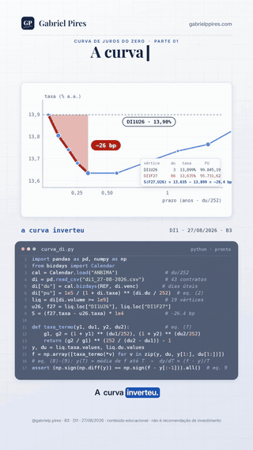
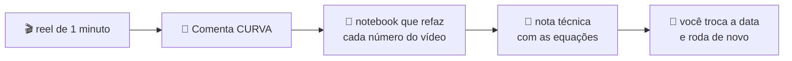

<!-- Semana nova: copie cada projeto para semana-NN/<nn>-<slug>/ (dados ao lado do notebook, caminhos relativos), ponha a
     capa do carrossel em assets/vitrine/ (540×675, JPG), uma linha na tabela "Os projetos", uma ficha em "As fichas", os
     quadrados do placar e os números dos selos (projetos, testes). -->

<div align="center">


# Do Reel ao Repo

**Você comentou CURVA. O notebook chegou.**

O código completo por trás dos reels de [@gabrielp.pires](https://instagram.com/gabrielp.pires): cada vídeo de um minuto
vira um projeto que roda, com dado público, conta aberta e nota técnica.

[](#-comece-em-30-segundos)
[](#-os-projetos)
[](#-os-projetos)
[](#projeto-04)
[](#-de-onde-vêm-os-dados)
[](https://instagram.com/gabrielp.pires)
[](https://gabrielppires.com)
[](LICENSE)


[Como funciona](#-como-funciona) · [Comece](#-comece-em-30-segundos) · [Projetos](#-os-projetos) · [Um gostinho](#-um-gostinho) · [Erratas](#-erratas-o-vídeo-falou-a-conta-corrigiu) · [Dados](#-de-onde-vêm-os-dados) · [FAQ](#-perguntas-que-sempre-aparecem)

</div>

---

> Todo reel terminava do mesmo jeito: *"Comenta CURVA que eu te mando o notebook no direct."*
> Mandar notebook de direct em direct não escala. Então o notebook mudou de endereço: agora ele mora aqui, aberto, para
> quem quiser rodar, quebrar e conferir cada número do vídeo. **Sem precisar comentar nada.** (Mas pode comentar. Eu gosto.)

<p align="center">
  <a href="#projeto-01"></a>
  <a href="#projeto-02"></a>
  <a href="#projeto-03"></a>
  <a href="#projeto-04"></a>
  <br><sub>As capas dos carrosséis da semana 1. Clique para ir ao projeto.</sub>
</p>

## 🎬 Como funciona



Cada reel pega **uma** pergunta que apareceu no noticiário (a curva inverteu, a eleição muda a dívida, o Tesouro IPCA+
despencou) e responde com conta. No vídeo cabe o gráfico, a equação e o código que cabe na tela.

Aqui cabe o resto: a leitura do arquivo bruto, a limpeza, as checagens que ninguém vê, os gráficos, as tabelas e a
parte mais importante de qualquer modelo, **o que ele não vê**.

Em cada pasta de projeto:

- 📓 **o notebook executado**, com as saídas na tela (dá para ler no GitHub sem rodar nada);
- 📊 **o arquivo bruto**, do jeito que sai da fonte;
- 📄 **a nota técnica ou o relatório** em PDF, com as equações numeradas;
- 🙈 **a seção final** com o que o modelo não vê.

<br clear="right">



| Pedaço do projeto | Onde mora |
|---|---|
| 🎬 Dois reels: um com rosto, um "do zero" com o código na tela | Instagram [@gabrielp.pires](https://instagram.com/gabrielp.pires) |
| 🖼️ Carrossel de 10 lâminas | Instagram [@gabrielp.pires](https://instagram.com/gabrielp.pires) |
| 📓 Notebook executado, com os dados ao lado | **aqui** 👇 |
| 📄 Nota técnica ou relatório em PDF | **aqui** 👇 |

## 🚀 Comece em 30 segundos

```bash
git clone https://github.com/gabrielp18/do-reel-ao-repo.git
cd do-reel-ao-repo
pip install -r requirements.txt
jupyter lab
```

Abra qualquer `.ipynb` e rode de cima para baixo. Cada pasta de projeto funciona sozinha: o dado está ao lado do
notebook, os caminhos são relativos e nenhum projeto pede chave de API.

**Sem instalar nada?** O modelo da dívida não lê arquivo nenhum e abre direto no navegador:
[](https://colab.research.google.com/github/gabrielp18/do-reel-ao-repo/blob/main/semana-01/02-divida-e-eleicoes-2026/modelo_divida_eleicoes2026_v2.ipynb)

Para os outros, rode isto numa célula do Colab antes (trocando a pasta pelo projeto que você quer):

```python
!git clone -q https://github.com/gabrielp18/do-reel-ao-repo.git
%cd do-reel-ao-repo/semana-01/01-curva-invertida
!pip install -q bizdays xlrd
```

## 📚 Os projetos

### Semana 1 · Juros, dívida e alocação

| # | Projeto | A pergunta do reel | O número que fica | Comenta | Abrir |
|:-:|---|---|---|:-:|:-:|
| 01 | [**A curva inverteu**](#projeto-01) | A curva DI inverteu. Vem recessão? | começo da curva em **−26,4 bips**: o mercado precifica pouco mais de **um corte** de 25 bips até janeiro | `CURVA` | [📓](semana-01/01-curva-invertida/curva_di_inclinacao_inversao.ipynb) [📄](semana-01/01-curva-invertida/curva_di_inclinacao_inversao_nota_tecnica.pdf) |
| 02 | [**A dívida e a urna**](#projeto-02) | Quanto a eleição muda a dívida até 2031? | a eleição explica **5%** da incerteza; os choques da economia, **89%** | `DÍVIDA` | [📓](semana-01/02-divida-e-eleicoes-2026/modelo_divida_eleicoes2026_v2.ipynb) [📄](semana-01/02-divida-e-eleicoes-2026/Eleicoes2026_Analise_Fiscal_Quantitativa_v2.pdf) |
| 03 | [**O susto do IPCA+ 2050**](#projeto-03) | Como o título que protege da inflação cai 12,6%? | **+76 bips** na taxa viram **−12,6%** no preço: 24 anos de prazo são alavanca | `IPCA` | [📓](semana-01/03-ipca-2050/ipca_marcacao_a_mercado.ipynb) [📄](semana-01/03-ipca-2050/ipca_longo_duration_convexidade_nota_tecnica.pdf) |
| 04 | [**Alocação macro BR**](#projeto-04) | Uma estratégia gringa funciona aqui? | **24 fatores**, **74 hipóteses** e o CDI com score próprio, porque aqui o caixa compete | `MACRO` | [📦](semana-01/04-alocacao-macro-br) [📓](semana-01/04-alocacao-macro-br/notebooks/pipeline_alocacao_macro.ipynb) |

<sub>📓 notebook · 📄 nota técnica ou relatório em PDF · 📦 pacote Python com testes</sub>

## 🗂️ As fichas

<a id="projeto-01"></a>

### 📉 01 · A curva de juros inverteu. Vem recessão?

> Em 27/08/2026, o DI de setembro pagava **13,899%** e o de janeiro, **13,635%**. Nos EUA, curva invertida virou sinônimo
> de recessão. Aqui, a conta diz outra coisa.

**No notebook, você vai:**

- ler o arquivo da B3 (com o volume no formato brasileiro, `"3.233.585.904,66"`), contar dias úteis no calendário
  ANBIMA e ficar com os **19 vértices** que negociaram mais de R\$ 1 bi;
- tratar cada DI1 como um zero-cupom, $PU = 100.000 / (1+i)^{du/252}$, e tirar as taxas a termo vértice a vértice;
- ver a curva em forma de colher (cai, faz um mínimo e sobe) e provar que os termos recompõem o DI de 2037 até a sexta
  casa decimal;
- separar expectativa de prêmio de prazo e entender por que a regra americana de Estrella & Mishkin (1998) não se
  transpõe para o Brasil.

A conta central é a taxa a termo, a taxa que a curva já trava hoje entre dois vencimentos:

$$
f = \left[\frac{(1+r_2)^{du_2/252}}{(1+r_1)^{du_1/252}}\right]^{252/(du_2-du_1)} - 1
$$

Se o longo paga menos que o curto, alguma taxa a termo à frente está abaixo da de hoje: é o mercado precificando juro
caindo. **Inversão aqui é preço de um caminho para o juro, não alarme de recessão.**

| Arquivo | O que é |
|---|---|
| [`curva_di_inclinacao_inversao.ipynb`](semana-01/01-curva-invertida/curva_di_inclinacao_inversao.ipynb) | o notebook, 11 seções, do CSV às limitações |
| [`contratos_di_futuro.csv`](semana-01/01-curva-invertida/contratos_di_futuro.csv) | os 43 contratos de DI1 do pregão de 27/08/2026 (B3) |
| [`…_nota_tecnica.pdf`](semana-01/01-curva-invertida/curva_di_inclinacao_inversao_nota_tecnica.pdf) | 16 páginas com as equações numeradas do reel "do zero" |

<a id="projeto-02"></a>

### 🗳️ 02 · A eleição explica só 5% do futuro da dívida

> Quem ganhar em outubro herda uma dívida de **82,5% do PIB**. Para ela parar de subir, o primário precisa ser de
> **3,1% do PIB**. Nenhum programa declarado chega lá.

**No notebook, você vai:**

- montar a aritmética da dívida e o primário que a estabiliza, $pb^* = d\,(r-g)/(1+g)$: com $d = 85\%$, $r = 5{,}2\%$
  (IFI) e $g = 1{,}5\%$ (Focus), dá 3,1% do PIB;
- rodar um modelo anual com prêmio, câmbio, Selic, PIB e custo da dívida para três cenários, cada um com o primário
  planejado no programa declarado de uma candidatura: executando o plano inteiro e sem choques, a dívida chega a 2031
  em **94,8%** no cenário A e **87,9%** no B1;
- descobrir com valores de Shapley de onde vêm esses 6,9 pontos (**81%** é o próprio primário);
- sortear a execução de cada programa e os choques macro, calibrados nos erros do Focus, em **20 mil trajetórias**:
  com a eleição meio a meio, a mediana vai a 94,5% e a chance de passar de 90% é de 74%;
- separar a variância pela lei da variância total: **89%** macro, **6%** execução, **5%** eleição.

Quer um ponto de partida mais novo? Troque para `ATUALIZAR = True` na seção 2 e a dívida inicial passa a vir do Focus mais
recente, pela API do Banco Central.

| Arquivo | O que é |
|---|---|
| [`modelo_divida_eleicoes2026_v2.ipynb`](semana-01/02-divida-e-eleicoes-2026/modelo_divida_eleicoes2026_v2.ipynb) | o modelo, com a revisão de 26/09 e a lista do que mudou |
| [`Eleicoes2026_Analise_Fiscal_Quantitativa_v2.pdf`](semana-01/02-divida-e-eleicoes-2026/Eleicoes2026_Analise_Fiscal_Quantitativa_v2.pdf) | o relatório, 22 páginas |
| [`apresentacao_eleicoes2026_v2.html`](semana-01/02-divida-e-eleicoes-2026/apresentacao_eleicoes2026_v2.html) | a apresentação (baixe e abra no navegador) |

> [!IMPORTANT]
> São cenários **condicionais** aos programas declarados: o que acontece com a dívida *se* cada plano for executado.
> Não é previsão, nem pesquisa eleitoral, nem recomendação de voto ou de investimento.

<a id="projeto-03"></a>

### 🧨 03 · O título que protege da inflação caiu 12,6%

> Entre 14/04 e 30/07/2026, o Tesouro IPCA+ 2050 foi de **R\$ 930,30** para **R\$ 812,75**. Sem calote, sem choque e com
> o IPCA correndo normal. Bastou a taxa subir de 6,90% para 7,66%.

**No notebook, você vai:**

- ler as abas da planilha do Tesouro Direto e conferir a fórmula pelo VNA implícito, que tem de sair suave e igual em
  todos os vencimentos (se der degrau, a contagem de dias úteis está errada);
- medir a duration e a convexidade de um zero-cupom de 24 anos: **+1 ponto na taxa tira 19,9%; −1 ponto soma 25,1%**.
  O preço é curva, não reta;
- decompor a queda em taxa (−15,6%), inflação (+1,5%) e carrego (+2,0%);
- comparar vencimentos (no mesmo período, o 2029 caiu 1,7%) e fazer a conta de quem vendeu no fundo contra quem segurou.

$$
PU_t = \frac{VNA_t}{(1+\text{taxa}_t)^{du_t/252}}
\qquad\qquad
\frac{\Delta P}{P} \approx -D_{mod}\,\Delta r + \tfrac{1}{2}\,C\,(\Delta r)^2
$$

Vender no fundo realizou **−15,0%**. Segurar até 2050 entrega **IPCA + 6,78%**, a taxa contratada. O preço oscila, o
contrato não.

| Arquivo | O que é |
|---|---|
| [`ipca_marcacao_a_mercado.ipynb`](semana-01/03-ipca-2050/ipca_marcacao_a_mercado.ipynb) | o notebook, da planilha à decisão de vender ou segurar |
| [`NTNB_Principal_2026.xls`](semana-01/03-ipca-2050/NTNB_Principal_2026.xls) | preços e taxas diárias do Tesouro IPCA+ em 2026, 164 dias úteis (Tesouro Transparente) |
| [`…_nota_tecnica.pdf`](semana-01/03-ipca-2050/ipca_longo_duration_convexidade_nota_tecnica.pdf) | 13 páginas sobre duration, convexidade e o que move a taxa real longa |

<a id="projeto-04"></a>

### 🧭 04 · Copiei uma estratégia gringa. No Brasil, ela quebra no caixa.

> Brine, Cereda & Sueppel (Macrosynergy, 2026) alocam o patrimônio entre classes de ativos usando só fatores macro. Em
> dólar, o caixa rende quase nada e entra como sobra. Em reais, o CDI é o maior concorrente de qualquer ativo. Então aqui
> ele ganha **score próprio**.

Este não é só um notebook: é um pacote Python (`amb`) com linha de comando, configuração declarada em YAML e **48 testes**.

- **24 fatores** em 5 blocos (juros, fiscal, atividade, externo e global), ligados a **10 classes** por **74 hipóteses**
  escritas antes de qualquer teste;
- cada fator vira z-score sequencial em torno do neutro teórico, só com o que já tinha sido divulgado na data: sem
  look-ahead;
- os scores viram pesos por SoftMax, com teto de 35% por classe. Um score 0,4 maior vira um peso 1,49 vez maior
  ($e^{0{,}4}$):

$$
w_i = \frac{e^{S_i/\tau}}{\sum_j e^{S_j/\tau}}
$$

- o backtest rebalanceia por trimestre, executa com defasagem e cobra 12 bips sobre o giro; o teste em painel usa erro
  agrupado por data, porque as classes andam juntas e o t ingênuo mente.

```bash
cd semana-01/04-alocacao-macro-br
PYTHONPATH=src python -m amb.cli exemplo     # gera dados sintéticos, sem rede
PYTHONPATH=src python -m amb.cli rodar       # o pipeline inteiro, CSVs em saida/
PYTHONPATH=src python -m pytest tests/ -q    # os 48 testes
```

> [!WARNING]
> O projeto vem com **dados sintéticos** (fictícios): eles provam que o pipeline roda de ponta a ponta, e um teste garante
> que o modelo **não** acha sinal em ruído. Os gráficos de desempenho que saem deles mostram o método funcionando, não um
> resultado para o Brasil. Para rodar com dado real, o [README do projeto](semana-01/04-alocacao-macro-br/README.md)
> lista cada série e onde baixar.

## 🧪 Um gostinho

O projeto 01 inteiro cabe nesta ideia. A taxa longa é a média das taxas a termo do caminho; se ela fica abaixo da curta,
o caminho desce. Rode isto da raiz do repositório:

```python
import pandas as pd
from bizdays import Calendar
cal = Calendar.load("ANBIMA")                                   # o calendário oficial do DI
di = pd.read_csv("semana-01/01-curva-invertida/contratos_di_futuro.csv")
di.columns = ["codigo", "venc", "taxa", "var", "hora", "volume"]
di["volume"] = di.volume.str.replace(".", "").str.replace(",", ".").astype(float)
di = di[di.volume >= 1e9].set_index("codigo")                   # 43 contratos → 19 vértices
venc = pd.to_datetime(di.venc, dayfirst=True).dt.date
di["du"] = [cal.bizdays("2026-08-27", cal.adjust_next(v)) for v in venc]
def termo(a, b):                                                # a taxa que a curva trava entre a e b
    ga, gb = (1 + di.taxa[a]/100) ** (di.du[a]/252), (1 + di.taxa[b]/100) ** (di.du[b]/252)
    return ((gb/ga) ** (252/(di.du[b] - di.du[a])) - 1) * 100
print(f"{(di.taxa['DI1F27'] - di.taxa['DI1U26']) * 100:.1f} bips")       # −26,4: começo invertido
print(f"{termo('DI1U26', 'DI1F27'):.3f} %")                              # 13,625: o CDI médio até janeiro
```

**Spoiler:** 13,899 − 13,625 = 27 bips. Pouco mais de um corte de 25 bips do Copom. Era só isso que a "inversão" estava
dizendo. [Abrir o notebook completo →](semana-01/01-curva-invertida/curva_di_inclinacao_inversao.ipynb)

## 🩹 Erratas (o vídeo falou, a conta corrigiu)

Vídeo não tem botão de editar. Quando a fala fica para trás da conta, a correção vai na legenda do post e aqui.

| Reel | O que o vídeo disse | O que a conta diz |
|---|---|---|
| 02 · dívida | a fala foi gravada com a versão anterior do modelo: 94,9%, 88,9%, "seis pontos", 95,4%, 91% e cerca de um décimo para eleição e para execução | revisão de 26/09, que já está na tela e no notebook: **94,8%**, **87,9%**, **6,9 pontos**, **94,5%**, **74%** e **5%** e **6%** |
| 03 · IPCA+ | inflação e carrego "tiraram outra parte" da queda | eles **somaram** 3,5 pontos (+1,5 e +2,0); a taxa sozinha tirou 15,6% |
| 03 · IPCA+ | o peso de 1/24 da Selic soou como resultado de estudo | é a aritmética de uma taxa de 24 anos, não um resultado empírico |

Achou outra? [Abra uma issue](https://github.com/gabrielp18/do-reel-ao-repo/issues). Errar em público é o melhor tipo de
erro: aparece, é corrigido e todo mundo aprende junto.

## 📏 Regras da casa

1. **Todo número do reel sai de uma célula do notebook.** Quando não sai, vira errata.
2. **Dado público, com fonte e data.** B3, Tesouro, Banco Central, IFI. O arquivo bruto mora ao lado do notebook.
3. **Fictício tem carimbo.** O relatório do projeto 04 sai com "FICTÍCIOS" na capa quando roda nos dados sintéticos.
4. **Todo modelo confessa o que não vê.** Cada notebook termina com as próprias limitações.
5. **Um projeto, uma pasta.** Copie a pasta, rode, pronto.
6. **Não é recomendação.** Nem de investimento, nem de voto.

## 🏆 O placar

| Contador | Quanto |
|---|---|
| 🎬 Reels com o código aqui | **8** (rosto + "do zero", nos quatro projetos) |
| 📓 Notebooks executados | **4** |
| 📄 Páginas de PDF técnico | **53** |
| 🧪 Testes | **48** |
| 🎲 Trajetórias de Monte Carlo | **20.000** |
| 📅 Dias úteis até o vencimento do IPCA+ 2050, contados em 02/01/2026 | **6.164** |
| 🔑 Chaves de API necessárias | **0** |

<sub>🟦 projeto no repo · ⬜ próximo</sub>

| Semana | Projetos |
|---|---|
| 1 · Juros, dívida e alocação | 🟦🟦🟦🟦 |
| 2 | ⬜ *a próxima pasta* |

## 🔎 De onde vêm os dados

| Fonte | O que vem de lá | Projeto |
|---|---|:-:|
| [B3](https://www.b3.com.br/) | DI1 do pregão de 27/08/2026: taxa do último negócio e volume dos 43 vencimentos | 01 |
| [Banco Central](https://www3.bcb.gov.br/sgspub/) (SGS, Estatísticas Fiscais, Focus) | dívida bruta (SGS 13762), primário, Selic e as expectativas do Focus | 02, 04 |
| [IFI](https://www12.senado.leg.br/ifi) | juro real implícito da dívida (RAF 113) | 02 |
| [Tesouro Transparente](https://www.tesourotransparente.gov.br/) | preços e taxas diárias do Tesouro IPCA+ (NTN-B Principal) em 2026 | 03 |
| [Macrosynergy](https://macrosynergy.com/research/) | o artigo replicado no projeto 04 | 04 |

Para rodar o projeto 04 com dado real, você baixa as séries de mercado (ANBIMA, B3, FGV, CAGED) e põe em
`dados/manual/`. O [README do projeto](semana-01/04-alocacao-macro-br/README.md) diz quais e de onde.

## 📂 Como o repositório está organizado

```text
do-reel-ao-repo/
├── semana-01/
│   ├── 01-curva-invertida/
│   │   ├── curva_di_inclinacao_inversao.ipynb
│   │   ├── contratos_di_futuro.csv          ← B3, 27/08/2026
│   │   └── curva_di_inclinacao_inversao_nota_tecnica.pdf
│   ├── 02-divida-e-eleicoes-2026/
│   │   ├── modelo_divida_eleicoes2026_v2.ipynb
│   │   ├── Eleicoes2026_Analise_Fiscal_Quantitativa_v2.pdf
│   │   └── apresentacao_eleicoes2026_v2.html
│   ├── 03-ipca-2050/
│   │   ├── ipca_marcacao_a_mercado.ipynb
│   │   ├── NTNB_Principal_2026.xls          ← Tesouro Transparente
│   │   └── ipca_longo_duration_convexidade_nota_tecnica.pdf
│   └── 04-alocacao-macro-br/                ← pacote Python com README próprio
│       ├── config/   src/amb/   tests/   notebooks/
│       └── Makefile
├── assets/                                  ← logo (gerado por logo.py), GIF, capas e prévia social
├── requirements.txt
└── LICENSE
```

## ❓ Perguntas que sempre aparecem

<details>
<summary><b>Preciso saber programar?</b></summary>
<br>
Se você já mexeu numa planilha, consegue acompanhar. Cada notebook explica a conta antes do código, e o código vem em
pedaços pequenos. Comece rodando tudo, depois mude um número (o corte de liquidez, a taxa, a chance de cada cenário) e
veja o que acontece.
</details>

<details>
<summary><b>Os números do notebook batem com os do vídeo?</b></summary>
<br>
Batem. Os notebooks 01 a 03 foram rodados de novo do zero, já dentro deste repositório, e reproduziram todas as saídas.
Onde a fala do vídeo ficou para trás da conta, a <a href="#-erratas-o-vídeo-falou-a-conta-corrigiu">errata</a> diz.
</details>

<details>
<summary><b>Posso trocar a data e rodar com dados de hoje?</b></summary>
<br>
Pode, e é a melhor parte. No 01, baixe os contratos de DI do dia no site da B3, troque <code>DATA_REF</code> e os
vértices citados pelo nome (eles mudam quando um contrato vence). No 03, troque a planilha do Tesouro Transparente: o topo e
o fundo são achados sozinhos, pelo drawdown. No 02, <code>ATUALIZAR = True</code> busca a dívida inicial no Focus mais
recente.
</details>

<details>
<summary><b>Por que um projeto fala de eleição?</b></summary>
<br>
Porque a dívida pública é a variável que mais pesa nos juros longos do Brasil, e outubro de 2026 decide quem vai
administrá-la. O modelo pega o primário que cada programa declarou e pergunta o que acontece com a dívida se ele for
cumprido, e se for cumprido pela metade. A resposta mais interessante não é sobre candidato: 89% da incerteza vem da
economia.
</details>

<details>
<summary><b>Posso usar no meu trabalho, na faculdade, no TCC?</b></summary>
<br>
Pode. O código é MIT: use, mude e redistribua, mantendo o aviso de licença. Se for publicar, cite o repositório e, no
projeto 04, o artigo original da Macrosynergy.
</details>

<details>
<summary><b>Isso é recomendação de investimento?</b></summary>
<br>
Não. É educação. Nenhum notebook diz o que comprar ou em quem votar. Eles mostram como a conta funciona, inclusive quando
ela não funciona.
</details>

## 🤝 Quer ajudar?

- ⭐ **Dê uma estrela.** Não muda a curva de juros, mas muda o meu dia.
- 🐛 **Achou um número estranho?** Abra uma issue com o projeto e a célula.
- 💡 **Tem um tema que deveria virar reel?** Sugira numa issue. Se vier com um artigo para replicar no Brasil, melhor ainda.
- 📲 **Quer o vídeo antes do código?** Siga [@gabrielp.pires](https://instagram.com/gabrielp.pires).
- 📺 **Quer começar do zero mesmo?** A série diária *Finanças Quantitativas do Zero* tem repositório próprio:
  [financas-quant-do-zero](https://github.com/gabrielp18/financas-quant-do-zero).

## ⚠️ Aviso

Conteúdo educacional. Nada aqui é recomendação de investimento, oferta, análise de valor mobiliário ou recomendação de
voto. Os cenários do projeto 02 são condicionais aos programas declarados. Os dados do projeto 04 são sintéticos até você
trocá-los. Resultado passado não garante resultado futuro, e isso vale em dobro para backtest.

## 📄 Licença e créditos

O código está sob a licença [MIT](LICENSE). Os dados ao lado dos notebooks pertencem às respectivas fontes (B3, Tesouro
Nacional, Banco Central, IFI) e seguem os termos de cada uma.

O projeto 04 adapta Brine, Eric, Cereda, Fabio e Sueppel, Ralph, *"Wealth management with macro factors"*, Macrosynergy
Research, agosto de 2026. Os resultados numéricos do artigo original são de uma carteira em dólar e não se transferem para
o Brasil. As demais referências (Estrella & Mishkin, Adrian, Crump & Moench e companhia) estão nas notas técnicas.

---

<div align="center">


<sub>A linha do logo é a curva DI de verdade do pregão de 27/08/2026: os 19 vencimentos com mais de R\$ 1 bi negociado,
com o prazo na raiz quadrada dos dias úteis para abrir o começo da curva. O trecho vermelho é a inversão, −26,4 bips do DI de setembro ao de janeiro.
Quer conferir? Rode <a href="assets/logo.py"><code>assets/logo.py</code></a>.</sub>

<sub>Feito com pandas, café e muitos dias úteis por <a href="https://gabrielppires.com">Gabriel Pires</a> ·
<a href="https://instagram.com/gabrielp.pires">@gabrielp.pires</a></sub>

</div>
