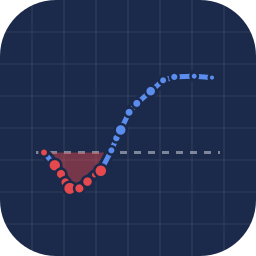

<div align="center">



# A curva de juros inverteu. Vem recessão?

**Projeto 01 · Semana 1 · [Do Reel ao Repo](../../README.md)**

*O DI de setembro pagava mais que o de janeiro. Nos EUA, isso é alarme de recessão. Aqui, é preço.*


[Em 20 segundos](#-em-20-segundos) · [Rode](#-rode) · [A conta](#-a-conta) · [O notebook](#-o-notebook-seção-por-seção) · [Caça ao número](#-caça-ao-número) · [Outra data](#-rode-com-outra-data) · [Limitações](#-o-que-este-modelo-não-vê)

</div>

---

## ⚡ Em 20 segundos

- Em 27/08/2026, o DI1 de setembro (`DI1U26`) pagava **13,899%** e o de janeiro (`DI1F27`), **13,635%**: o começo da
  curva estava **26,4 bips** invertido.
- A taxa longa é a média das taxas a termo do caminho. Se ela fica abaixo da curta, alguma taxa à frente está mais
  baixa: o mercado está **precificando juro caindo**.
- Quanto? O termo de setembro a janeiro é **13,625%**, 27 bips abaixo do curto. Pouco mais de **um corte** de 25 bips.
- Do segundo ano em diante a curva sobe para 14,4–14,7%. O desenho é uma **colher**, não uma curva invertida de livro.
- Por isso a regra americana (Estrella & Mishkin, 1998) não se transpõe: **inversão aqui é preço de um caminho para o
  juro, não alarme de recessão.**

## 🏃 Rode

```bash
pip install pandas numpy matplotlib bizdays jupyterlab
jupyter lab curva_di_inclinacao_inversao.ipynb
```

O CSV está nesta pasta e o calendário ANBIMA vem dentro do `bizdays`: nada para baixar, nenhuma chave de API.

<details>
<summary><b>No Colab</b></summary>
<br>

```python
!git clone -q https://github.com/gabrielp18/do-reel-ao-repo.git
%cd do-reel-ao-repo/semana-01/01-curva-invertida
!pip install -q bizdays
```

Depois, abra o notebook pelo menu *Arquivo → Abrir notebook* e rode de cima para baixo.
</details>

## 🧮 A conta

Cada DI1 é um título zero-cupom sintético. Com `du` dias úteis até o vencimento e a taxa $i$ ao ano, base 252:

$$
PU = \frac{100.000}{(1+i)^{du/252}}
$$

Aplicar direto até $du_2$ precisa render o mesmo que aplicar até $du_1$ e reaplicar por uma taxa travada hoje. Isolando
essa taxa, a **taxa a termo**:

$$
f = \left[\frac{(1+r_2)^{du_2/252}}{(1+r_1)^{du_1/252}}\right]^{252/(du_2-du_1)} - 1
$$

A taxa longa é uma média composta da curta com a termo. Então, se $r_2 < r_1$, só pode ser porque $f < r_1$:
**curva invertida ⇔ taxa a termo abaixo da taxa curta.**

A ressalva que muda tudo: a termo = expectativa **+ prêmio de prazo**. Um termo alto pode ser só prêmio, e o prêmio mexe a
curva sem que ninguém mude de ideia sobre a Selic.

## 📖 O notebook, seção por seção

| § | O que acontece | O que sai |
|:-:|---|---|
| 1 | Bibliotecas, data de referência, corte de liquidez e o calendário ANBIMA | `DATA_REF`, `VOLUME_MIN = 1e9` |
| 2 | Leitura do CSV da B3 e o volume no formato brasileiro (`"3.233.585.904,66"`) | 43 contratos, de 01/09/2026 a 01/01/2039 |
| 3 | Dias úteis: o vencimento vai para o primeiro dia útil do mês | `du`, prazo em anos e o PU de cada contrato |
| 4 | Filtro de liquidez de R\$ 1 bi | **19 vértices** mantidos, 24 removidos (o `DI1F39` negociou menos de R\$ 40 mil) |
| 5 | Curvas ilustrativas: inclinada e invertida | dois desenhos de livro, sem dado de mercado |
| 6 | A taxa a termo por não arbitragem, com uma checagem de 1 e 2 anos | 14% e 13% dão um termo de 12,009% |
| 7 | A curva real de 27/08/2026 | a colher: mínimo no `DI1F27`, 14,450% no `DI1F37` |
| 8 | Zoom no primeiro ano e meio | **F27 − U26 = −26,4 bips** |
| 9 | Taxas a termo vértice a vértice e nos seis trechos do vídeo | o caminho implícito do CDI e a curva recomposta pelos próprios termos |
| 10 | Três medidas de inclinação | −26,4, +43,0 e +82,0 bips |
| 11 | Interpretação e limitações | o que a inversão diz e o que ela não promete |

## 🔎 Caça ao número

Todo número do reel tem endereço no notebook.

| No reel | Valor | Onde sai |
|---|---|---|
| a taxa do curto e a de janeiro | 13,899% e 13,635% | § 2 (tabela) e § 7 (`print`) |
| os vértices líquidos | 19 de 43 | § 4 |
| a inversão do começo | **−26,4 bips** | § 8 e § 10 |
| o caminho implícito do CDI | 13,79 → 13,67 → 13,54 → 13,50% | § 9 (a), pares consecutivos de U26 a F27 |
| o CDI médio até janeiro | **13,625%** (27 bips abaixo do curto) | § 9 (b), trecho `U26→F27` |
| a inclinação de 2 e de 6 anos | +43 e +82 bips | § 10 |
| a prova de que a conta fecha | o F37 recomposto pelos termos: 14,450000% | § 9, "Checagem de consistência" |

## 📦 Arquivos

| Arquivo | O que é |
|---|---|
| [`curva_di_inclinacao_inversao.ipynb`](curva_di_inclinacao_inversao.ipynb) | o notebook, executado, com todos os gráficos do reel |
| [`contratos_di_futuro.csv`](contratos_di_futuro.csv) | os 43 contratos de DI1 do pregão de 27/08/2026: código, vencimento, taxa do último negócio, variação, horário e volume (B3) |
| [`curva_di_inclinacao_inversao_nota_tecnica.pdf`](curva_di_inclinacao_inversao_nota_tecnica.pdf) | 16 páginas: o contrato, a curva zero, o teorema da inclinação, as duas causas da inversão (bear × bull flattening), prêmio de prazo e a literatura de previsão de recessão |

O reel "do zero" digita na tela uma versão compacta destas contas. A nota técnica traz as equações numeradas que o
vídeo cita, incluindo as que o notebook não cobre (o prêmio de prazo estimado à la Adrian, Crump & Moench e o
probit de recessão).

## 🔁 Rode com outra data

1. Baixe os contratos de DI1 do dia no site da B3 (mesmas seis colunas) e salve por cima de `contratos_di_futuro.csv`.
2. Na § 1, troque `DATA_REF` pela data do arquivo.
3. Os vértices citados pelo nome (`DI1U26`, `DI1F27`, os seis trechos da § 9) mudam quando um contrato vence: troque
   pelos equivalentes da nova data. O curto é o vencimento mais próximo; os janeiros (`F`) são os mais líquidos.
4. Rode tudo. Se a § 9 recompuser o vértice mais longo até a sexta casa, a conta está certa.

Teste também outro corte de liquidez em `VOLUME_MIN` e veja quanto os termos entre vértices próximos se mexem.

## 🙈 O que este modelo não vê

- **Prêmio de prazo.** A taxa a termo é expectativa + prêmio, e o prêmio varia no tempo. Um termo alto pode ser prêmio,
  não aposta em alta da Selic.
- **Expectativas mudam.** A curva é a foto de um dia: reprecifica a cada IPCA, ata do Copom ou susto fiscal.
- **Último negócio, não ajuste.** Os contratos negociaram em horários diferentes. Para pesquisa, prefira as taxas de
  ajuste da B3 ou a curva da ANBIMA.
- **O corte de R\$ 1 bi é escolha prática,** não regra de mercado.
- **Termos entre vértices próximos são ruidosos:** 1 ou 2 bips na taxa viram dezenas de bips no termo.

## 📚 Para ir além

- Estrella, A. e Mishkin, F. S. (1998). *Predicting U.S. recessions: financial variables as leading indicators.*
  Review of Economics and Statistics.
- Fama, E. F. e Bliss, R. R. (1987). *The information in long-maturity forward rates.* American Economic Review.
- Adrian, T., Crump, R. K. e Moench, E. (2013). *Pricing the term structure with linear regressions.* Journal of
  Financial Economics.
- Brito, R. D., Duarte, A. J. M. e Guillén, O. T. C. (2003). *O prêmio pela maturidade na estrutura a termo das taxas de
  juros brasileiras.* Banco Central do Brasil, Trabalhos para Discussão 72.

A lista completa está no fim da nota técnica.

---

<div align="center">

<sub>Conteúdo educacional · não é recomendação de investimento · dados: B3, pregão de 27/08/2026</sub>

[⬅️ Voltar ao repositório](../../README.md) · [Projeto 02: a dívida e a urna ➡️](../02-divida-e-eleicoes-2026/README.md)

</div>
