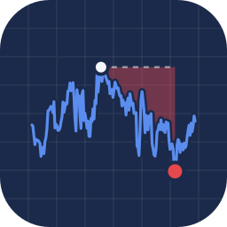

<div align="center">



# O título que protege da inflação caiu 12,6%

**Projeto 03 · Semana 1 · [Do Reel ao Repo](../../README.md)**

*De abril a julho, sem calote, sem choque e com o IPCA correndo normal. Bastou a taxa subir 76 bips.*


[Em 20 segundos](#-em-20-segundos) · [Rode](#-rode) · [A conta](#-a-conta) · [O notebook](#-o-notebook-seção-por-seção) · [Caça ao número](#-caça-ao-número) · [Errata](#-errata) · [Outro ano](#-rode-com-outro-ano) · [Limitações](#-o-que-este-modelo-não-vê)

</div>

---

## ⚡ Em 20 segundos

- Entre 14/04 e 30/07/2026, o Tesouro IPCA+ 2050 foi de **R\$ 930,30** para **R\$ 812,75**: **−12,6%**.
- Nada quebrou. A taxa real que o mercado pede subiu de **6,90%** para **7,66%**, e um título sem cupom de 24 anos
  amplifica isso: a duration é o prazo inteiro.
- A taxa sozinha tirou 15,6% do preço. A inflação (+1,5%) e a passagem do tempo (+2,0%) devolveram uma parte.
- No mesmo ano, o pior tombo do IPCA+ 2029 foi de 1,7%. **Quanto mais longo, maior o susto.**
- Quem vendeu no fundo realizou **−15,0%**. Quem segurou continua com **IPCA + 6,78%** até 2050. O preço oscila, o
  contrato não.

## 🏃 Rode

```bash
pip install pandas numpy matplotlib bizdays xlrd jupyterlab
jupyter lab ipca_marcacao_a_mercado.ipynb
```

A planilha do Tesouro está nesta pasta. O `xlrd` existe só para ler o `.xls`; o calendário ANBIMA vem dentro do `bizdays`.

<details>
<summary><b>No Colab</b></summary>
<br>

```python
!git clone -q https://github.com/gabrielp18/do-reel-ao-repo.git
%cd do-reel-ao-repo/semana-01/03-ipca-2050
!pip install -q bizdays xlrd
```

Depois, abra o notebook pelo menu *Arquivo → Abrir notebook* e rode de cima para baixo.
</details>

## 🧮 A conta

O Tesouro IPCA+ (a NTN-B Principal) paga no vencimento o **VNA**: R\$ 1.000 de julho de 2000 corrigidos pelo IPCA. O preço
de hoje é esse valor descontado pela taxa real do dia:

$$
PU_t = \frac{VNA_t}{(1+\text{taxa}_t)^{du_t/252}}
$$

Se a taxa sobe no mesmo dia, o VNA se cancela e sobra a sensibilidade pura. A reta é a duration; a curva é a verdade:

$$
\frac{\Delta PU}{PU} \approx -D_{mod}\,\Delta y, \qquad D_{mod} = \frac{\tau}{1+y}
\qquad\qquad
\frac{PU_{novo}}{PU} - 1 = \left(\frac{1+y}{1+y+\Delta y}\right)^{\tau} - 1
$$

E a queda se divide **exatamente** em três pedaços, tirando o log do preço:

$$
\Delta \ln PU = \underbrace{\ln\frac{VNA_2}{VNA_1}}_{\text{inflação}}
\;-\; \underbrace{\frac{du_2}{252}\left[\ln(1+y_2)-\ln(1+y_1)\right]}_{\text{efeito taxa}}
\;+\; \underbrace{\frac{du_1-du_2}{252}\ln(1+y_1)}_{\text{carrego}}
$$

## 📖 O notebook, seção por seção

| § | O que acontece | O que sai |
|:-:|---|---|
| 1 | Bibliotecas, o arquivo e os seis vencimentos usados | a aba de 2026 fica de fora: venceu dentro da janela |
| 2 | Como funciona o Tesouro IPCA+ | VNA, taxa de compra × taxa de venda e por que o certo é olhar o PU de venda |
| 3 | Leitura das abas da planilha | **164 dias úteis**, de 02/01 a 27/08/2026 |
| 4 | Checagem pelo VNA implícito | as seis curvas se sobrepõem: +3,46% no período, sem degrau |
| 5 | Duration e convexidade, com as taxas de 27/08 | 2050: $D_{mod}$ de 22,18; +1 ponto tira **19,8%** (a reta diria 22,2%) |
| 6 | A trajetória real do IPCA+ 2050 e o drawdown | topo em 14/04, fundo em 30/07, **+76 bips** e **−12,64%** |
| 7 | A queda decomposta | taxa −15,57%, inflação +1,47%, carrego +1,98% |
| 8 | Quanto mais longo, maior o susto | o pior tombo de cada vencimento: de −1,74% (2029) a −12,64% (2050) |
| 9 | Vender no fundo × segurar até o vencimento | −15,02% realizados contra IPCA + 6,78% contratados |

## 🔎 Caça ao número

| No reel | Valor | Onde sai |
|---|---|---|
| o preço no topo e no fundo | R\$ 930,30 e R\$ 812,75 | § 6 |
| a taxa no topo e no fundo | 6,90% e 7,66% (**+76 bips**) | § 6 |
| a queda | **−12,6%** | § 6 e § 7 |
| a inflação no VNA | +3,46% no período inteiro | § 4 |
| taxa, inflação e carrego | −15,6%, +1,5% e +2,0% | § 7 |
| a alavanca da duration | 2029: −1,7%; 2050: −12,6% | § 8 |
| vender no fundo | **−15,0%**, já com o spread de compra e venda | § 9 |
| segurar até 2050 | **IPCA + 6,78%**, a taxa de compra de 14/04 | § 9 |

O reel "do zero" também mostra a duration e a convexidade medidas no dia do fundo ($D_{mod}$ = 22,29 e $C$ = 517,7) e a
assimetria de ±1 ponto (−19,9% contra +25,1%). Essas contas estão na nota técnica.

## 🩹 Errata

| A fala disse | A conta diz |
|---|---|
| inflação e carrego "tiraram outra parte" da queda | eles **somaram** 3,5 pontos (+1,5 e +2,0); a taxa sozinha tirou 15,6% |
| o peso de 1/24 da Selic soou como resultado de estudo | é a aritmética de uma taxa de 24 anos, não um resultado empírico |

## 📦 Arquivos

| Arquivo | O que é |
|---|---|
| [`ipca_marcacao_a_mercado.ipynb`](ipca_marcacao_a_mercado.ipynb) | o notebook, executado, com todos os gráficos do reel |
| [`NTNB_Principal_2026.xls`](NTNB_Principal_2026.xls) | preços e taxas diárias do Tesouro IPCA+ em 2026, uma aba por vencimento (Tesouro Transparente) |
| [`ipca_longo_duration_convexidade_nota_tecnica.pdf`](ipca_longo_duration_convexidade_nota_tecnica.pdf) | 13 páginas: VNA e indexação, duration e convexidade em base 252, *pull to par*, imunização, o que move a taxa real longa e os limites da proteção do IPCA |

## 🔁 Rode com outro ano

1. Baixe a planilha do Tesouro IPCA+ (NTN-B Principal) do ano que você quer no histórico de preços e taxas do
   [Tesouro Transparente](https://www.tesourotransparente.gov.br/) e salve nesta pasta.
2. Na § 1, aponte `ARQUIVO` para ela e confira o dicionário `VENCIMENTOS`: o nome de cada aba e a data de vencimento.
3. Rode tudo. O topo e o fundo são achados sozinhos pelo drawdown, e a § 4 avisa se a contagem de dias úteis errar.

## 🙈 O que este modelo não vê

- **Imposto e custódia.** Os resultados são brutos. O IR incide sobre o ganho nominal, inflação inclusa.
- **A sua inflação.** O IPCA é a cesta média do país, com defasagem de indexação: protege da inflação média, não da sua.
- **Compra não é venda.** O notebook mede a posição pelo PU de venda (o valor de resgate); quem compra paga a taxa de
  compra, um pouco menor.
- **O gráfico final da § 9 é ilustrativo:** uma taxa inventada oscilando em torno da contratada, só para mostrar a
  convergência ao VNA.
- **Por que a taxa subiu** fica fora do notebook. Numa taxa de 24 anos, quem manda é o prêmio (risco fiscal, oferta de
  títulos, juro global), e isso está na nota técnica.

## 📚 Para ir além

- Macaulay, F. R. (1938). *Some theoretical problems suggested by the movements of interest rates, bond yields and stock
  prices in the United States since 1856.* NBER.
- Redington, F. M. (1952). *Review of the principles of life-office valuations.* Journal of the Institute of Actuaries.
- Campbell, J. Y., Shiller, R. J. e Viceira, L. M. (2009). *Understanding inflation-indexed bond markets.* Brookings
  Papers on Economic Activity.
- Vayanos, D. e Vila, J.-L. (2021). *A preferred-habitat model of the term structure of interest rates.* Econometrica.

A lista completa está no fim da nota técnica.

---

<div align="center">

<sub>Conteúdo educacional · não é recomendação de investimento · dados: Tesouro Transparente, preços e taxas de 2026</sub>

[⬅️ Projeto 02: a dívida e a urna](../02-divida-e-eleicoes-2026/README.md) · [Voltar ao repositório](../../README.md) · [Projeto 04: alocação macro ➡️](../04-alocacao-macro-br/README.md)

</div>
