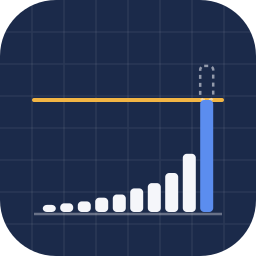

<div align="center">



# Alocação Macro - Brasil

**Projeto 04 · Semana 1 · [Do Reel ao Repo](../../README.md)**

*Copiei uma estratégia gringa. No Brasil, ela quebra no caixa.*

Alocação entre classes de ativos guiada por fatores macro, para um investidor com passivo em reais. Adaptação de
**Brine, Cereda & Sueppel, "Wealth management with macro factors"** (Macrosynergy research, agosto de 2026): mantém o
método e troca o mundo.


[Em 20 segundos](#-em-20-segundos) · [Rode](#-rode-em-três-comandos) · [Caça ao número](#-caça-ao-número) · [O método](#o-que-este-projeto-faz) · [Dados reais](#rodando-com-dados-reais) · [Estrutura](#estrutura)

</div>

---

## ⚡ Em 20 segundos

- No artigo original, em dólar, o caixa rende pouco e entra como **sobra**: score fixo em zero.
- Em reais, o CDI é o maior concorrente de qualquer ativo. No reel, o número que mostra isso: em 25 anos, o CDI rendeu
  11,8% ao ano contra 12,8% da bolsa (NEFIN; número citado no vídeo, não calculado neste projeto). Por isso, aqui o
  **caixa ganha score próprio**.
- O resto vira **24 fatores** brasileiros em 5 blocos (juros, fiscal, atividade, externo e global), ligados a
  **10 classes** de ativos por **74 hipóteses** escritas antes de qualquer teste.
- Cada fator vira z-score só com o que já tinha sido divulgado na data (13 séries andam para a data de divulgação), os
  scores viram pesos por SoftMax com teto de 35%, e o backtest cobra custo e corre contra o CDI.

> [!WARNING]
> Os dados que vêm aqui são **sintéticos** (fictícios). Eles provam que o pipeline roda de ponta a ponta, e um teste
> garante que o modelo **não** acha sinal em ruído. Os gráficos de desempenho que saem deles mostram o método funcionando,
> não um resultado para o Brasil. Para rodar com dado real, veja [Rodando com dados reais](#rodando-com-dados-reais).

## 🏃 Rode em três comandos

```bash
pip install -r requirements.txt
PYTHONPATH=src python -m amb.cli exemplo     # gera dados sintéticos em dados/manual/, sem rede
PYTHONPATH=src python -m amb.cli rodar       # o pipeline inteiro, CSVs em saida/
```

Com `make` instalado, é `make exemplo && make rodar`; os testes são `make teste`. O passo a passo comentado, com os
gráficos de cada etapa, está em [`notebooks/pipeline_alocacao_macro.ipynb`](notebooks/pipeline_alocacao_macro.ipynb).

## 🔎 Caça ao número

| No reel | Valor | Onde mora |
|---|---|---|
| os fatores | 24, em 5 blocos | [`src/amb/fatores.py`](src/amb/fatores.py), no `REGISTRO` |
| as hipóteses | 74, com o sinal esperado | [`config/hipoteses.yaml`](config/hipoteses.yaml) |
| as hipóteses do caixa | 4: juro real ex-ante, ciclo do Copom, CDS Brasil e VIX | `hipoteses.yaml`, bloco `CAIXA` |
| as classes | 10, cada uma com um ativo investível (BOVA11, IMA-B 5, IFIX, Tesouro Selic…) | [`config/classes.yaml`](config/classes.yaml) |
| as séries com defasagem | 13 de 29 | [`config/series.yaml`](config/series.yaml), campo `defasagem_dias` |
| o SoftMax | $w_i = e^{S_i/\tau} / \sum_j e^{S_j/\tau}$, com τ = 1 fixo | [`src/amb/carteira.py`](src/amb/carteira.py) e `params.yaml` |
| 0,4 de score a mais | vira 1,49 vez o peso ($e^{0{,}4}$) | a própria fórmula |
| o teto por classe | 35% | [`config/params.yaml`](config/params.yaml), `peso_maximo` |
| o custo | 12 bips sobre o giro | `params.yaml`, `custo_bps` |
| o rebalanceamento | trimestral, com 1 período de defasagem | `params.yaml`, `frequencia_rebalance` e `defasagem_execucao` |
| o teste em painel | retorno de 3 meses, erro agrupado por data | [`src/amb/backtest.py`](src/amb/backtest.py) e `params.yaml` |
| os testes | 48 | [`tests/`](tests) |

## O que este projeto faz

Constrói 24 fatores macroeconômicos a partir de indicadores brutos, normaliza
sequencialmente sem look-ahead, compõe um score por classe de ativo a partir de
74 hipóteses declaradas antes do teste, converte scores em pesos via SoftMax e
simula a carteira contra o CDI.

```
indicadores brutos  →  defasagem de publicação  →  24 fatores
        →  z-score sequencial  →  score por classe  →  SoftMax  →  backtest
```

## A adaptação que importa

No artigo original, o caixa é a posição de risk-off e entra com **score fixo
zero** — é o resíduo. Faz sentido em dólar, cuja taxa de curto prazo ficou perto
de zero durante boa parte da amostra.

Em reais não vale. O CDI é o **principal concorrente de toda classe de ativo**:
em vários episódios o juro real ex-ante brasileiro passou de 7% ao ano. Nenhum
ativo de risco precisa piorar para o caixa merecer mais alocação — basta o real
ex-ante subir.

Aqui o **CAIXA recebe seu próprio score**, com quatro hipóteses (juro real
ex-ante, ciclo do Copom, CDS Brasil, VIX). O SoftMax arbitra entre onze
competidores, não dez mais um resíduo.

Outras três divergências, todas declaradas em `config/`:

| Mudança | Razão |
|---|---|
| Teto de 35% por classe | Sem teto o SoftMax concentra em regimes extremos. Em reais, com correlação de scores maior, o problema é pior |
| Erro-padrão agrupado por data no painel | As classes se movem juntas. Tratar 10 classes × 100 trimestres como 1.000 observações independentes infla a significância |
| Custo de transação incluído | O artigo original o exclui, e é transparente quanto a isso. Para investidor brasileiro real, ETF de renda fixa, IFIX e câmbio têm custo que não é desprezível |
| Benchmark é o CDI | Único comparativo honesto para patrimônio em reais |

## Instalação

```bash
pip install -r requirements.txt
make verificar
```

`verificar` confere que toda hipótese cita um fator implementado, que todo fator
implementado é usado, e avisa quais códigos SGS ainda não foram conferidos.

## Notebook

`notebooks/pipeline_alocacao_macro.ipynb` percorre o pipeline etapa por etapa, com o
diagnóstico de cada uma, e termina gerando o PDF. É a versão aberta do comando
`python -m amb.cli relatorio`. Abra o Jupyter de dentro desta pasta: o notebook acha
a raiz do projeto sozinho.

## Saídas

```bash
make rodar                                        # CSVs em saida/
python -m amb.cli relatorio --sintetico           # PDF
python -m amb.cli relatorio --sintetico --html    # dashboard navegável
```

O PDF é para circular; o HTML é para navegar — abrir a definição de cada fator, ver a
matriz das 74 hipóteses, inspecionar o diagnóstico de cada etapa do pipeline. Os dois
carregam a natureza dos dados na capa.

## Rodando sem dados reais

```bash
make exemplo   # gera dados sintéticos em dados/manual/
make rodar
```

> Os dados sintéticos são **fictícios**. Servem para validar que o pipeline roda
> de ponta a ponta, não para inferir nada sobre o Brasil. Um teste da suíte
> verifica justamente que o modelo **não** encontra sinal em ruído.

## Rodando com dados reais

### 1. Confira os códigos do SGS

Em `config/series.yaml`, seis códigos estão marcados com `conferir: true`.
**Confira cada um em https://www3.bcb.gov.br/sgspub antes de rodar.** Um código
errado não gera erro — gera uma série plausível e um resultado inventado.

### 2. Forneça as séries que o BCB não publica

Coloque CSVs em `dados/manual/`, com uma coluna `data` e as demais nomeadas
conforme `config/series.yaml`:

| Arquivo | Colunas | Onde obter |
|---|---|---|
| `curva_di.csv` | di_3m, di_1a, di_5a, ntnb_10a | ANBIMA (ETTJ) ou B3 (ajustes de DI1) |
| `mercado.csv` | cds_5a, dxy, vix, us_real_5y, commodities, termos_troca, pmi_global, cambio_real | Provedor de mercado; termos de troca na FUNCEX |
| `fgv.csv` | nuci, ici | FGV IBRE (Sondagem da Indústria) |
| `emprego.csv` | caged_3m | Novo CAGED |
| `retornos.csv` | ret_acoes_br, ret_acoes_global, ret_imab5, ret_imab5mais, ret_irfm, ret_ida, ret_usd, ret_ouro, ret_ifix, ret_cdi | B3, ANBIMA (IMA, IDA), provedor |

Frequência diária ou mensal — o carregador resolve.

### 3. Rode

```bash
make rodar
```

Séries ausentes são reportadas e o fator correspondente é pulado, com aviso. O
pipeline não quebra por falta de uma série, mas **o diagnóstico de cobertura por
classe precisa ser lido**: uma classe cujo fator dominante ficou de fora tem
score, mas não tem significado.

## O problema dos dados point-in-time

É o obstáculo real da adaptação. O artigo original depende do JPMaQS, que entrega
séries point-in-time. No Brasil isso quase não existe de graça. Três naturezas,
três tratamentos:

**Focus — point-in-time por construção.** Cada coleta semanal do Boletim Focus é
um vintage datado, e a API de Expectativas entrega o histórico com a data da
coleta. Não há revisão possível. É o ativo mais valioso do arcabouço brasileiro,
e a *revisão* das expectativas é um sinal de surpresa macro limpo.

**Séries de mercado — não sofrem revisão.** DI, ETTJ, NTN-B, PTAX, CDS, IMA,
IFIX. O preço de ontem é o preço de ontem.

**Séries revisadas — exigem defasagem explícita.** PIB, PIM-PF, IBC-Br, CAGED,
contas externas. O IPCA de janeiro só existe por volta de 10 de fevereiro. No
código isso é o campo `defasagem_dias` de `config/series.yaml`, aplicado em
`calendario.aplicar_defasagem`.

> A diferença entre estudo sério e mineração, no Brasil, quase sempre está na
> defasagem de publicação. É a linha mais fácil de esquecer e a que mais infla
> resultado. Um backtest que usa o PIB de 2015 revisado em 2018 para decidir
> alocação em 2015 não está testando nada.

Agravante: o CAGED mudou de metodologia em 2020. Séries de emprego merecem
desconfiança específica em backtest longo.

## Estrutura

```
config/
  classes.yaml     10 classes, proxy investível, grupo, exposição cambial
  series.yaml      29 séries com fonte e defasagem de publicação
  hipoteses.yaml   74 hipóteses declaradas, com sinal esperado
  params.yaml      normalização, SoftMax, backtest — nada otimizado
src/amb/
  calendario.py    defasagem, agregação, alinhamento
  fontes.py        SGS, Focus, CSV manual, cache
  fatores.py       os 24 fatores. Registro declarativo com insumos e neutro
  scores.py        z-score sequencial, paridade conceitual, diagnóstico
  carteira.py      SoftMax com caixa competitivo, teto, métricas
  backtest.py      simulação, métricas, painel com clustering
  pipeline.py      orquestração
  cli.py           verificar | exemplo | rodar | relatorio
  relatorio.py     gera o PDF, com a natureza dos dados na capa e no rodapé
  dashboard.py     gera o dashboard HTML navegável
  dashboard.html   modelo do dashboard
  sintetico.py     fixtures fictícias
notebooks/
  pipeline_alocacao_macro.ipynb
tests/             48 testes
```

## Onde estão as decisões de método

**Normalização em torno do neutro teórico, não da média amostral.** Hiato de
inflação normaliza em torno de zero (a meta), não da inflação média do período.
Normalizar pela média da amostra embute o resultado no sinal — é a forma mais
comum e mais invisível de look-ahead. Cada fator declara seu neutro em
`fatores.py`.

**Paridade conceitual.** Peso igual para cada hipótese economicamente distinta,
sem otimização. O que não existe não pode ser sobreajustado.

**Temperatura do SoftMax fixa em 1, e não otimizada.** Otimizar a temperatura em
dados históricos é otimizar a estratégia inteira por uma porta lateral.

**Sinal separado da construção.** `fatores.py` constrói na direção "mais é mais";
`hipoteses.yaml` diz se mais favorece ou desfavorece cada classe. Misturar as
duas coisas é o caminho mais rápido para um erro de sinal que ninguém encontra
depois.

## Citação

O trabalho original deve ser citado conforme os autores pedem:

> Brine, Eric, Cereda, Fabio, and Sueppel, Ralph, "Wealth management with macro
> factors", Macrosynergy research, August 2026.

Esta é uma adaptação derivada: mantém o método (paridade conceitual, scores
point-in-time, SoftMax, teste em painel) e substitui o universo de ativos, o
conjunto de fatores, a moeda de referência e o tratamento do caixa. **Os
resultados numéricos do artigo original referem-se a uma carteira em dólar e não
são transferíveis para o Brasil.**

---

## Licença

MIT, a mesma do repositório inteiro — veja [LICENSE](../../LICENSE).

## Autor

**Gabriel Pires** · [@gabrielp.pires](https://instagram.com/gabrielp.pires) · [gabrielppires.com](https://gabrielppires.com)

Este projeto é o 04 da semana 1 do [Do Reel ao Repo](../../README.md).

## Aviso

Código e análises com finalidade educacional. Não constitui recomendação de
investimento. Backtests não representam desempenho real.

---

<div align="center">

<sub>Conteúdo educacional · não é recomendação de investimento · dados inclusos: sintéticos</sub>

[⬅️ Projeto 03: o susto do IPCA+](../03-ipca-2050/README.md) · [Voltar ao repositório](../../README.md)

</div>